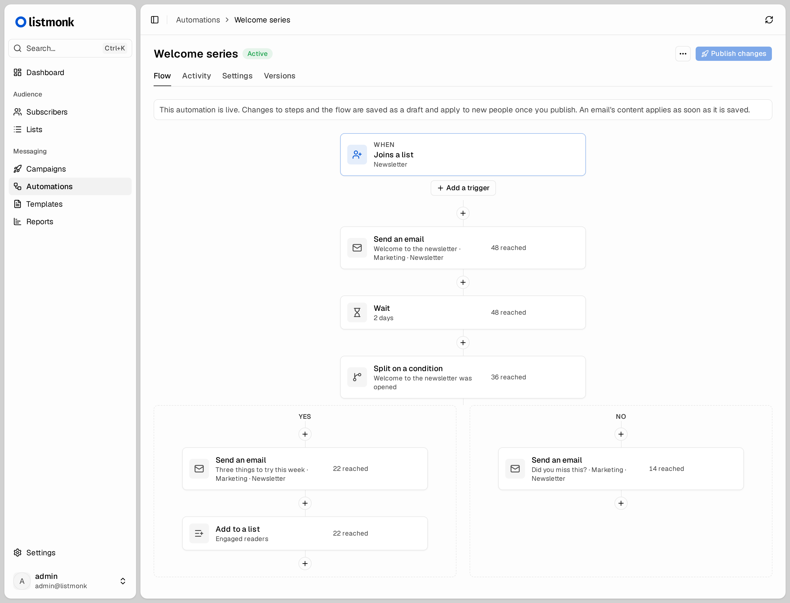

# listmonk (fork) — new admin UI and marketing automation

> [!CAUTION]
> This fork is new and has not yet been proven in production. Use it at your own risk. Back up your database before
> installing or upgrading, pin a release tag rather than `latest`, and try it on a copy of your data first.

A fork of [listmonk](https://github.com/knadh/listmonk), the self-hosted newsletter and mailing list manager. It adds:

- **A new admin UI**, built with Vue 3 and shadcn-vue, with dark mode.
- **Marketing automation**: drip sequences and journeys started by list joins, attribute changes, or events from your
  app (`POST /api/track`).
- **A message log** of every email sent, with the mail server's response.
- **Drop-in replacement**: swap the image in an existing listmonk install and run `--upgrade`. Your lists,
  subscribers, campaigns and APIs carry over, and you can switch back to stock listmonk later.

<picture>
  <source media="(prefers-color-scheme: dark)" srcset=".github/assets/automation-dark.png">
  
</picture>

It is not affiliated with the listmonk project. For everything else, see [listmonk.app](https://listmonk.app/docs).

## Tracking events

Send events from your app to start automations, or to resume ones waiting on an event. Use an API user with the
`track:send` permission:

```shell
curl -u 'api_user:token' -X POST http://localhost:9000/api/track \
  -H 'Content-Type: application/json' \
  -H 'Idempotency-Key: order-1234' \
  -d '{
    "subscriber": {"email": "jane@example.com", "name": "Jane"},
    "name": "order_placed",
    "properties": {"total": 42},
    "upsert_attribs": {"plan": "pro"}
  }'
```

- `subscriber`: either `id` or `email`. An unknown email creates the subscriber, without subscribing them to any list.
- `name`: the event name that automations match on.
- `properties` (optional): event data. Emails can use it, for example `{{ .Event.Properties.total }}`.
- `upsert_attribs` (optional): merged into the subscriber's attributes before the event is recorded.
- `occurred_at` (optional): an RFC 3339 timestamp. The default is now.
- `Idempotency-Key` header (optional): a retried request with the same key is recorded only once.

## Installation

Images are published to `ghcr.io/michaelholmes4/listmonk:<tag>` (see
[releases](https://github.com/michaelholmes4/listmonk/releases)). The image is a drop-in replacement for
`listmonk/listmonk`: use upstream's [docker-compose.yml](docker-compose.yml) and change `image:`.

To switch an existing install, back up the database, change the image, then run `./listmonk --upgrade --yes`.
The sample compose file already runs this on every start.

## Development

`make dev` in the dev container starts the API (`:9000`), the admin UI (`:5173`) and Mailpit (`:8025`). See
[FORK.md](FORK.md) for how the fork tracks upstream.

## License

AGPL v3, like listmonk. See [LICENSE](LICENSE) and [NOTICE](NOTICE).
